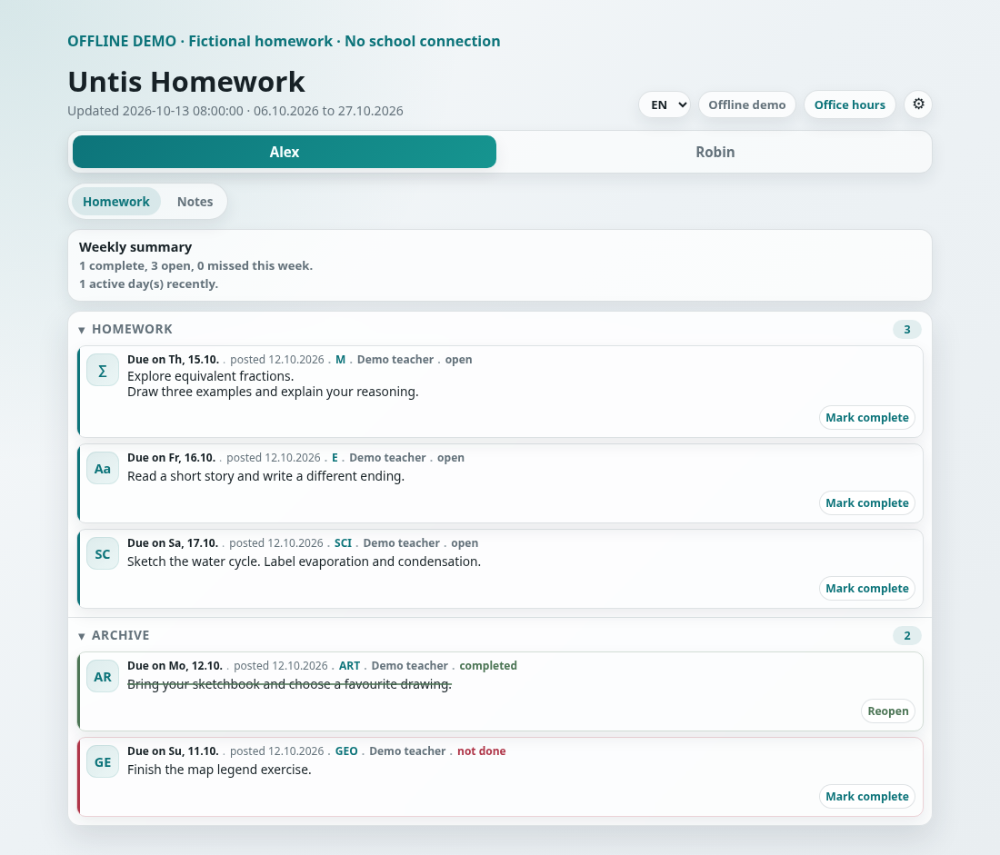
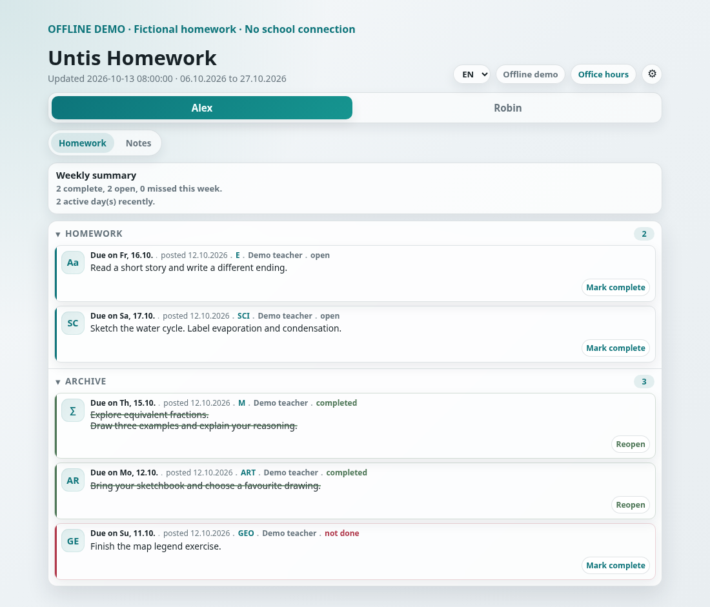
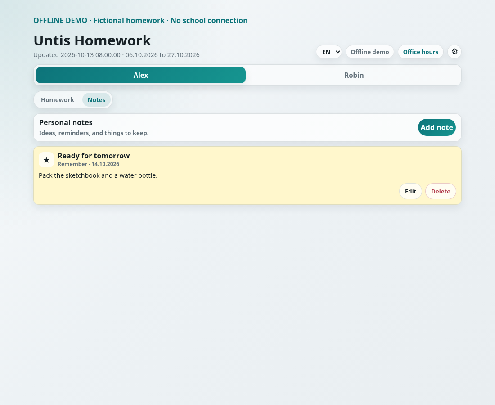
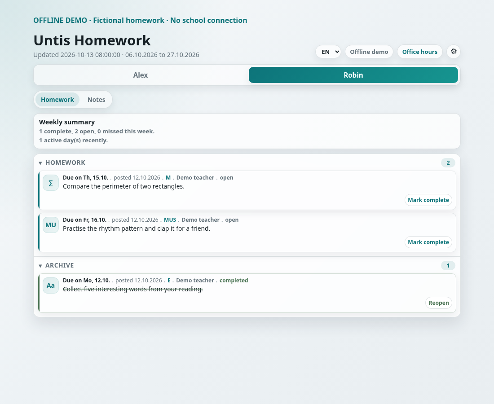

# Untis Homework

### Homework, without the daily scramble.

What is due next? What is already finished? Which child was that task for?
This small family homework interface keeps those answers together, with separate
child views, local completion tracking, subject colours and room for reminders.

**This release is an offline demonstration with fictional data. It does not
connect to a school, WebUntis account or hosted backend.** Open the real dashboard
and explore the workflow without credentials, then adapt the source for your own
project.

<table>
<tr><th>See the week ahead</th><th>Move finished work out of the way</th></tr>
<tr><td></td><td></td></tr>
<tr><th>Keep a small reminder</th><th>Give each child a separate view</th></tr>
<tr><td></td><td></td></tr>
</table>

These are genuine Chromium captures of the included dashboard. All names and
homework are invented; the demonstration clock is fixed to 13 October 2026.

## Try it

Open [`docs/index.html`](docs/index.html) from your downloaded checkout in Chromium.
There is no server to install. Mark a task complete, reload, switch between Alex
and Robin, write a note, or change a subject's colour. State stays in your browser.
The settings dialog can reset this demo without clearing unrelated browser data.

The included Kotlin/Compose Android app presents the same synthetic homework,
with open/archive views, swipe completion and persistent child/subject appearance.
It has no Internet permission or account client. Build instructions are in
[the validation guide](docs/validation.md).

## What is here

- The browser dashboard, local adapter and fixed fictional fixtures.
- An offline Android implementation and focused JVM tests.
- Python normalization, completion tracking, notes and appearance storage helpers.
- Swift model, codec and colour references with codec tests. These are **untested
  porting references**, not a buildable iOS application.

Live school integration, account/password storage, production gateway, deployment
and app-store scripts, iOS UI/host, original private history and unverified artwork
are excluded. The browser has notes; the Android edition focuses on homework.
Neither is a complete live school client in this source release.

## Build and check

```bash
python3 -m unittest discover -s tests
npm ci --ignore-scripts
npx playwright install chromium
npm run test:browser
# With Java 17 and Android SDK/platform 36 available:
cd app/mobile/android
./gradlew testDebugUnitTest assembleDebug
```

The candidate passed 18 Python tests, 13 Android JVM tests and two browser
workflows, including completion/notes persistence, child separation, 320/390px
layouts and network-call guards. See [validation and its limits](docs/validation.md).
Build outputs are local development artifacts; this source prerelease distributes
no APK, IPA or other installable app.

## Take it further

Experimental and unmaintained. There is no support, review, security-update or
release commitment. Fork it, adapt the family workflow, or become its maintainer.
Live integration would require your own authorized access and a separate security
and terms review; it has not been tested here.

First-party code, tests and documentation use [MIT](LICENSE). Separately licensed
components retain their [third-party notices](THIRD_PARTY_NOTICES.md).
This is an independent project, not affiliated with or endorsed by Untis or
WebUntis. Their names and marks are not granted by this project's license.

Local state is ordinary browser storage or Android preferences, not an encrypted
vault. Imported pictures and notes remain on that device; clearing app/browser
storage removes them. See [SECURITY.md](SECURITY.md).
